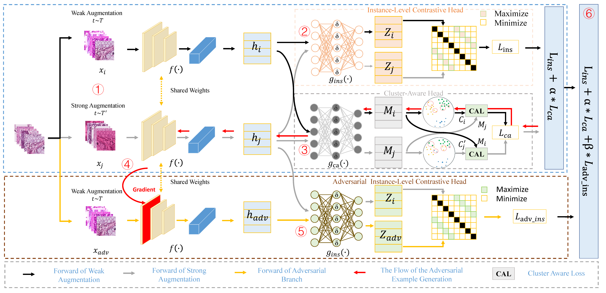

## CA2CL: Cluster-Aware Adversarial Contrastive Learning for Pathological Image Analysis

[English](#english) | [中文](#中文)

### English


#### Abstract
Pathological diagnosis assists in saving human lives, but such models are annotation hungry and pathological images are notably expensive to annotate. Contrastive learning could be a promising solution that relies only on unlabeled training data to generate informative representations. However, current contrastive learning methods often suffer from (1) easy positives from random augmentation and (2) false negative pairs caused by negative sampling bias. We propose Cluster-Aware Adversarial Contrastive Learning (CA^2CL) to address these issues. A mixed data augmentation strategy produces more discriminative pairs to learn transferable representations. A cluster-aware loss detects similarities between instances and uses them during contrastive learning to reduce false negatives. Adversarial learning further generates challenging pairs and enforces robust representations by maximizing similarity between augmented samples and related adversarial samples without labeled data. Evaluations on NCT-CRC-HE and PCam for fine-tuning/linear tasks and on GlaS and CRAG for detection/segmentation demonstrate superior performance over SSL baselines and ImageNet pretraining, especially with limited data.



#### Overview
This is a PyTorch implementation of CA2CL.

#### Preparation
Download the NCT-CRC-HE-100K and CRC-VAL-HE-7K datasets: [NCT dataset](https://zenodo.org/record/1214456).

#### Unsupervised Training
To run unsupervised pre-training of a ResNet-18 model on NCT-CRC-HE-100K with 2×A100 (40G) GPUs:
```
CUDA_VISIBLE_DEVICES=0,1 python pretrain.py
```
The NCT pre-trained checkpoint is available at [checkpoint](https://drive.google.com/file/d/14YcAzF3Foi5qF_fPxVV85aPOiCkuGdlr/view?usp=drive_link).

#### Fine-tuning
With a pre-trained model, train a supervised linear classifier on frozen features/weights on a single GPU:
```
python ft_le.py --dataset_path "../data/Kather_Multi_Class/" \
                --model_name "resnet18" \
                --model_path "./save/NCT/pretrain/resnet18/CA2CL_NCT.tar" \
                --ft_epoch 40 \
                --lr 0.0003 \
                --seed 1 \
                --only_fine_turning \
                --labeled_train 0.01 \
                --gpu_index 3
```

Fine-tuning results on CRC-VAL-HE-7K (seed=1):
<table><tbody>
<!-- START TABLE -->
<!-- TABLE HEADER -->
<th valign="bottom"></th>
<th valign="bottom">label of train<br/>1%</th>
<th valign="bottom">label of train<br/>10%</th>
<th valign="bottom">label of train<br/>50%</th>
<th valign="bottom">label of train<br/>100%</th>
<!-- TABLE BODY -->
<tr><td align="center">acc</td>
<td align="center">0.958</td>
<td align="center">0.967</td>
<td align="center">0.968</td>
<td align="center">0.970</td>

</tr>
<!-- TABLE BODY -->
<tr><td align="center">f1</td>
<td align="center">0.941</td>
<td align="center">0.954</td>
<td align="center">0.957</td>
<td align="center">0.960</td>
</tr>
<!-- TABLE BODY -->
<tr><td align="center">logs</td>
<td align="center"><a href="https://drive.google.com/drive/folders/1hZ0l13WNMdmSG1mjzDE-s8QNiBEBJ6zl?usp=drive_link">download</a></td>
<td align="center"><a href="https://drive.google.com/drive/folders/1hZ0l13WNMdmSG1mjzDE-s8QNiBEBJ6zl?usp=drive_link">download</a></td>
<td align="center"><a href="https://drive.google.com/drive/folders/1hZ0l13WNMdmSG1mjzDE-s8QNiBEBJ6zl?usp=drive_link">download</a></td>
<td align="center"><a href="https://drive.google.com/drive/folders/1hZ0l13WNMdmSG1mjzDE-s8QNiBEBJ6zl?usp=drive_link">download</a></td>
</tr>
</tbody></table>

#### Linear Classification
With a pre-trained model, train a supervised linear classifier on frozen features/weights:
```
python ft_le.py --dataset_path "../data/Kather_Multi_Class/" \
                --model_name "resnet18" \
                --model_path "./save/NCT/pretrain/resnet18/CA2CL_NCT.tar" \
                --ft_epoch 100 \
                --lr 0.01 \
                --seed 1 \
                --only_linear_eval \
                --labeled_train 0.01 \
                --gpu_index 3
```

Linear classification results on CRC-VAL-HE-7K (seed=1):
<table><tbody>
<!-- START TABLE -->
<!-- TABLE HEADER -->
<th valign="bottom"></th>
<th valign="bottom">label of train<br/>1%</th>
<th valign="bottom">label of train<br/>10%</th>
<th valign="bottom">label of train<br/>50%</th>
<th valign="bottom">label of train<br/>100%</th>
<!-- TABLE BODY -->
<tr><td align="center">acc</td>
<td align="center">0.967</td>
<td align="center">0.969</td>
<td align="center">0.969</td>
<td align="center">0.968</td>

</tr>
<!-- TABLE BODY -->
<tr><td align="center">f1</td>
<td align="center">0.953</td>
<td align="center">0.959</td>
<td align="center">0.958</td>
<td align="center">0.956</td>
</tr>
<!-- TABLE BODY -->
<tr><td align="center">logs</td>
<td align="center"><a href="https://drive.google.com/drive/folders/1BwM_F7ZDSXZfe0Ne7kWRR0KUdFHRXyrt?usp=drive_link">download</a></td>
<td align="center"><a href="https://drive.google.com/drive/folders/1BwM_F7ZDSXZfe0Ne7kWRR0KUdFHRXyrt?usp=drive_link">download</a></td>
<td align="center"><a href="https://drive.google.com/drive/folders/1BwM_F7ZDSXZfe0Ne7kWRR0KUdFHRXyrt?usp=drive_link">download</a></td>
<td align="center"><a href="https://drive.google.com/drive/folders/1BwM_F7ZDSXZfe0Ne7kWRR0KUdFHRXyrt?usp=drive_link">download</a></td>
</tr>
</tbody></table>

#### Transferring to Object Detection
We follow the evaluation setting in MoCo when transferring to object detection.
1. Install [detectron2](https://github.com/facebookresearch/detectron2/blob/master/INSTALL.md).
2. Download our pre-processed datasets: [GlaS-coco-format](https://drive.google.com/file/d/1tFmQqDwyfOMJhKO9jjyg7c0V0aJkXR4W/view?usp=drive_link) and [CRAG-coco-format](https://drive.google.com/file/d/1kGg-0f2eV3n36UBmiBzertxJcco5QdLv/view?usp=drive_link).
3. Place datasets under `benchmarks/detection/datasets` following the [directory structure](https://github.com/facebookresearch/detectron2/tree/master/datasets) required by detectron2.
4. The converted backbone weights are available at [checkpoint](https://drive.google.com/file/d/1Xd8aMQZMDW1V4fe-ZjdqGnDqFlBLeeoD/view?usp=drive_link); put them under `benchmarks/detection/converted_weights`.
5. Run `run_ft.sh` for fine-tuning and evaluation on the GlaS dataset.

#### License
This project is under the CC-BY-NC 4.0 license. See [LICENSE](LICENSE) for details.

#### Reference

If you find our work and this repository helpful in your research, we would appreciate it if you could cite our paper. Please use the following BibTeX entry.

```bibtex
@article{li20252,
  title={CA 2 CL: Cluster-Aware Adversarial Contrastive Learning for Pathological Image Analysis},
  author={Li, Junjian and Kuang, Hulin and Liu, Jin and Yue, Hailin and Wang, Jianxin},
  journal={IEEE Journal of Biomedical and Health Informatics},
  year={2025},
  publisher={IEEE}
}
```


---

### 中文


#### 摘要
病理诊断有助于挽救人类生命，但这类模型极度依赖标注数据，而病理图像的标注成本尤为高昂。对比学习作为一种有前景的解决方案，仅需利用未标注的训练数据即可生成信息丰富的表征。然而，现有的对比学习方法往往存在两大缺陷：（1）随机数据增强产生的简单正样本对；（2）负采样偏差导致的虚假负样本对。针对这些问题，我们提出聚类感知对抗对比学习方法。该方法采用混合数据增强策略生成更具判别性的样本对，从而学习可迁移的表征；通过聚类感知损失函数检测样本间的相似性，并在对比学习过程中利用这些信息减少虚假负样本对；同时引入对抗学习机制，在无标注数据条件下生成具有挑战性的样本对，并通过最大化增强样本与相关对抗样本间的相似性来强化表征的鲁棒性。在NCT-CRC-HE与PCam数据集上的微调/线性任务评估，以及在GlaS与CRAG数据集上的检测/分割任务评估表明，该方法在有限数据条件下显著优于自监督学习基线模型与ImageNet预训练模型，展现出卓越的性能。


#### 概述
这是 CA2CL 的 PyTorch 实现。

#### 准备工作
下载 NCT-CRC-HE-100K 与 CRC-VAL-HE-7K 数据集：[NCT 数据集](https://zenodo.org/record/1214456)。

#### 无监督预训练
在 2 张 A100 (40G) GPU 上，对 NCT-CRC-HE-100K 进行 ResNet-18 的无监督预训练：
```
CUDA_VISIBLE_DEVICES=0,1 python pretrain.py
```
NCT 预训练权重下载：[checkpoint](https://drive.google.com/file/d/14YcAzF3Foi5qF_fPxVV85aPOiCkuGdlr/view?usp=drive_link)。

#### 微调
使用预训练模型，在单卡上基于冻结特征/权重训练线性分类器：
```
python ft_le.py --dataset_path "../data/Kather_Multi_Class/" \
                --model_name "resnet18" \
                --model_path "./save/NCT/pretrain/resnet18/CA2CL_NCT.tar" \
                --ft_epoch 40 \
                --lr 0.0003 \
                --seed 1 \
                --only_fine_turning \
                --labeled_train 0.01 \
                --gpu_index 3
```

CRC-VAL-HE-7K 微调结果（seed=1）：
<table><tbody>
<!-- START TABLE -->
<!-- TABLE HEADER -->
<th valign="bottom"></th>
<th valign="bottom">label of train<br/>1%</th>
<th valign="bottom">label of train<br/>10%</th>
<th valign="bottom">label of train<br/>50%</th>
<th valign="bottom">label of train<br/>100%</th>
<!-- TABLE BODY -->
<tr><td align="center">acc</td>
<td align="center">0.958</td>
<td align="center">0.967</td>
<td align="center">0.968</td>
<td align="center">0.970</td>

</tr>
<!-- TABLE BODY -->
<tr><td align="center">f1</td>
<td align="center">0.941</td>
<td align="center">0.954</td>
<td align="center">0.957</td>
<td align="center">0.960</td>
</tr>
<!-- TABLE BODY -->
<tr><td align="center">logs</td>
<td align="center"><a href="https://drive.google.com/drive/folders/1hZ0l13WNMdmSG1mjzDE-s8QNiBEBJ6zl?usp=drive_link">download</a></td>
<td align="center"><a href="https://drive.google.com/drive/folders/1hZ0l13WNMdmSG1mjzDE-s8QNiBEBJ6zl?usp=drive_link">download</a></td>
<td align="center"><a href="https://drive.google.com/drive/folders/1hZ0l13WNMdmSG1mjzDE-s8QNiBEBJ6zl?usp=drive_link">download</a></td>
<td align="center"><a href="https://drive.google.com/drive/folders/1hZ0l13WNMdmSG1mjzDE-s8QNiBEBJ6zl?usp=drive_link">download</a></td>
</tr>
</tbody></table>

#### 线性评估
使用预训练模型，基于冻结特征/权重进行线性评估：
```
python ft_le.py --dataset_path "../data/Kather_Multi_Class/" \
                --model_name "resnet18" \
                --model_path "./save/NCT/pretrain/resnet18/CA2CL_NCT.tar" \
                --ft_epoch 100 \
                --lr 0.01 \
                --seed 1 \
                --only_linear_eval \
                --labeled_train 0.01 \
                --gpu_index 3
```

CRC-VAL-HE-7K 线性评估结果（seed=1）：
<table><tbody>
<!-- START TABLE -->
<!-- TABLE HEADER -->
<th valign="bottom"></th>
<th valign="bottom">label of train<br/>1%</th>
<th valign="bottom">label of train<br/>10%</th>
<th valign="bottom">label of train<br/>50%</th>
<th valign="bottom">label of train<br/>100%</th>
<!-- TABLE BODY -->
<tr><td align="center">acc</td>
<td align="center">0.967</td>
<td align="center">0.969</td>
<td align="center">0.969</td>
<td align="center">0.968</td>

</tr>
<!-- TABLE BODY -->
<tr><td align="center">f1</td>
<td align="center">0.953</td>
<td align="center">0.959</td>
<td align="center">0.958</td>
<td align="center">0.956</td>
</tr>
<!-- TABLE BODY -->
<tr><td align="center">logs</td>
<td align="center"><a href="https://drive.google.com/drive/folders/1BwM_F7ZDSXZfe0Ne7kWRR0KUdFHRXyrt?usp=drive_link">download</a></td>
<td align="center"><a href="https://drive.google.com/drive/folders/1BwM_F7ZDSXZfe0Ne7kWRR0KUdFHRXyrt?usp=drive_link">download</a></td>
<td align="center"><a href="https://drive.google.com/drive/folders/1BwM_F7ZDSXZfe0Ne7kWRR0KUdFHRXyrt?usp=drive_link">download</a></td>
<td align="center"><a href="https://drive.google.com/drive/folders/1BwM_F7ZDSXZfe0Ne7kWRR0KUdFHRXyrt?usp=drive_link">download</a></td>
</tr>
</tbody></table>

#### 迁移到目标检测
遵循 MoCo 的评估设置进行目标检测迁移：
1. 安装 [detectron2](https://github.com/facebookresearch/detectron2/blob/master/INSTALL.md)。
2. 下载预处理数据集：[GlaS-coco-format](https://drive.google.com/file/d/1tFmQqDwyfOMJhKO9jjyg7c0V0aJkXR4W/view?usp=drive_link) 与 [CRAG-coco-format](https://drive.google.com/file/d/1kGg-0f2eV3n36UBmiBzertxJcco5QdLv/view?usp=drive_link)。
3. 按 detectron2 要求的 [目录结构](https://github.com/facebookresearch/detectron2/tree/master/datasets)，将数据集放到 `benchmarks/detection/datasets`。
4. 转换后的骨干权重下载：[checkpoint](https://drive.google.com/file/d/1Xd8aMQZMDW1V4fe-ZjdqGnDqFlBLeeoD/view?usp=drive_link)，放入 `benchmarks/detection/converted_weights`。
5. 运行 `run_ft.sh` 在 GlaS 数据集上进行微调与评估。

#### 许可证
本项目基于 CC-BY-NC 4.0 许可证发布，详见 [LICENSE](LICENSE)。

#### 参考文献


如果您发现我们的工作和这个存储库对您的研究有帮助，如果您能引用我们的论文，我们将不胜感激。请使用以下 BibTeX 条目。

```bibtex
@article{li20252,
  title={CA 2 CL: Cluster-Aware Adversarial Contrastive Learning for Pathological Image Analysis},
  author={Li, Junjian and Kuang, Hulin and Liu, Jin and Yue, Hailin and Wang, Jianxin},
  journal={IEEE Journal of Biomedical and Health Informatics},
  year={2025},
  publisher={IEEE}
}
```


